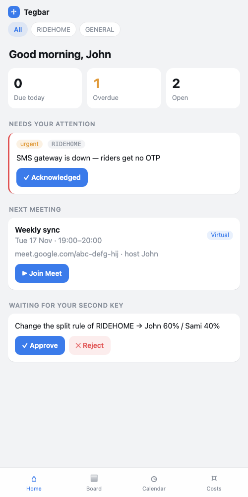
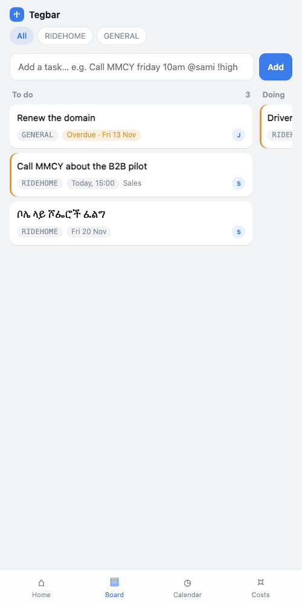
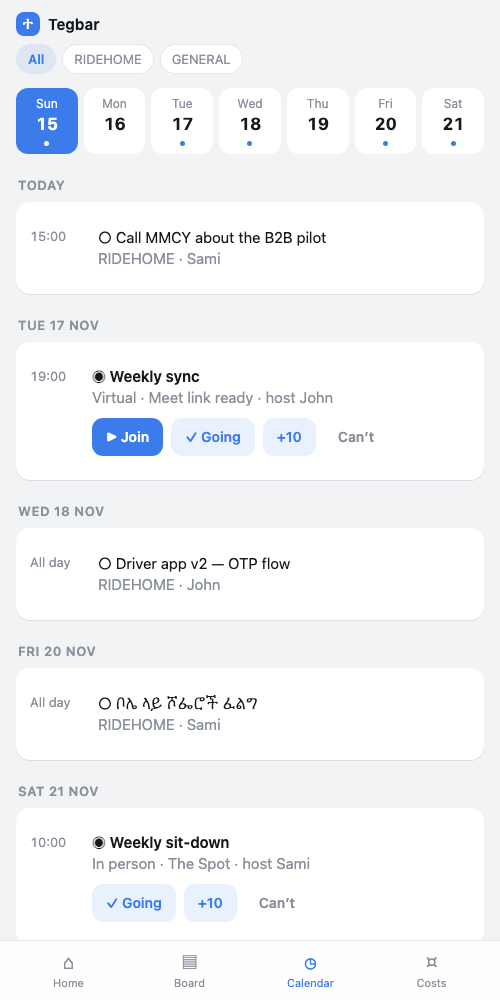
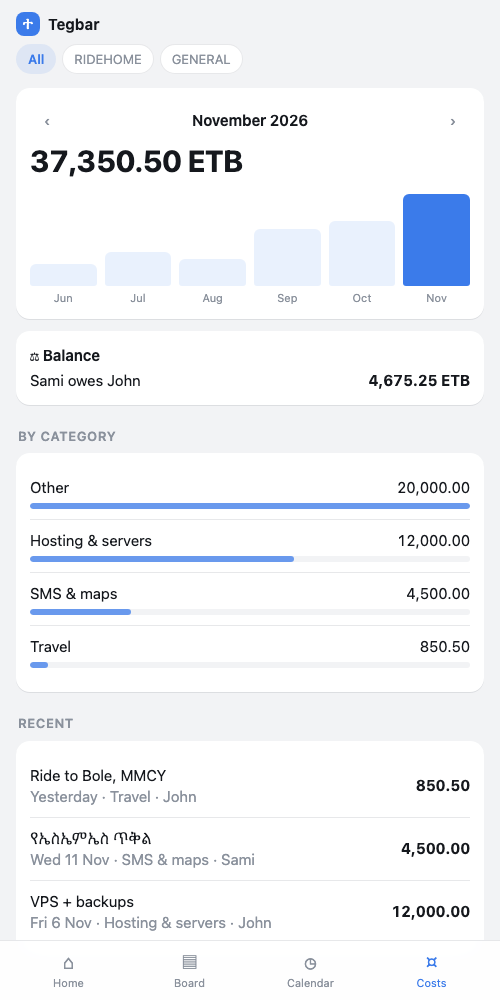
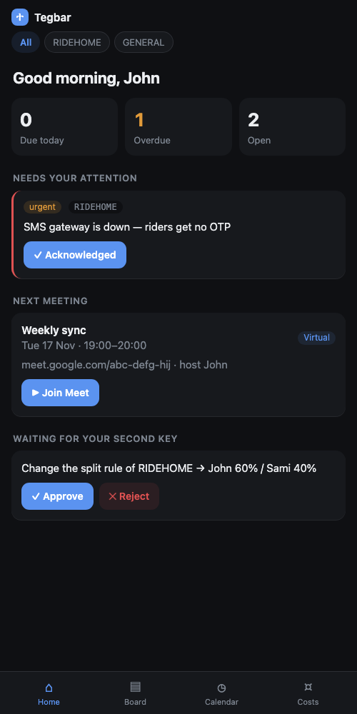

# Tegbar · ተግባር

A private co-founder operating system that lives in Telegram. It is built for two
founders today, and is organised around **projects** so it can take on more projects, people and modules later.
RideHome is the first project; `General` holds company-wide items.

> Tegbar is **not** accounting software, and Telegram bot chats are **not**
> end-to-end encrypted. Never send passwords, API keys, ID numbers or legal secrets.

## What works now (Phase 1)

- One-time pairing with `SETUP_CODE`. The first two people become co-founders A and B, then registration closes for good. Everyone else gets no reply.
- Projects: create, rename, describe, add links, change status (idea → active → paused → done), archive, switch the current project, use a `#code` override in any command.
- Areas per project, with default owners (tech areas → A, business areas → B).
- Tasks:
  - Quick add from one line (`Call MMCY tomorrow 10am @sami !high #ridehome #sales`).
  - A confirmation card when anything is ambiguous.
  - Done, Snooze, Edit, Reassign, Delete with confirmation, and Restore / `/undo`.
  - Full history of every change.
  - Views `/my /ours /today /week /overdue` with owner, project and status filters and pagination.
  - The partner gets a notification when you assign them a task.
- `/dashboard` across projects and people, `/settings` (current project, 24h/12h), `/menu`, `/help`.
- An append-only event log, feature flags, typed settings, Docker, a health check, structured logs, graceful shutdown, and critical-error alerts to co-founder A.

**Phase 2, reminders and rhythm:**

- Task reminders. By default you get one 1 day before and one 1 hour before; change these in `/settings`. You also always get one at the due time. Date-only tasks remind you at 09:00 on the day.
- Overdue nudges, capped at 3, once a day.
- Recurring tasks: `every monday 9am`, `weekdays`, `every 2 weeks on fri`, `monthly on the 1st`, `every 3 days`. The next copy is created when you mark the current one done.
- One-off reminders: `/remind me|us|@sami <when> <text>`, with Snooze and Cancel.
- Digests, each with its own time per person: the daily digest (08:00), Week ahead (Mon 08:30) and Week in review (Fri 17:00).
- Quiet hours (22:00–07:00 by default), **Focus** (`/focus 2h`) and **Do not disturb** (`/focus dnd 1h`):
  - Quiet hours and Do not disturb hold back automatic nudges and messages from your partner.
  - Focus holds back automatic nudges only.
  - Held messages are delivered later, never dropped.

**Phase 3, meetings:**

- Two weekly slots are seeded; change them in `/meetings` → ⚙ Slots. **Weekly sync** is Tue 19:00, 60 min, virtual. **Weekly sit-down** is Sat 10:00, 90 min, in person at **The Spot, Kazanchis**.
- Meetings are generated 8 weeks ahead, and the host alternates every week.
- Per-meeting changes: move, skip or un-skip, switch virtual/in person, host, place, length, Meet link. You can also add extra one-off meetings. None of these change the weekly slot.
- Virtual meetings:
  - Set the link with `/meeting link meet.google.com/abc-defg-hij`. It is validated, and a slot can also have a reusable room link.
  - The host is reminded to add the link 2 hours before. At the start, both of you are alerted if it is still missing.
  - Every reminder has a **▶ Join Meet** button.
- In person: there is a saved places list with a default. Reminders show the address, and a map venue if you have added a pin (📎 → Location).
- Reminders go out the evening before (20:00), 1 hour before, 10 minutes before and at the start. Each one has RSVP buttons: Going, +10, +20, Can't.
  "Can't" lets you propose another time, which your partner accepts in one tap.
- Calendar files: `.ics` for one meeting or all upcoming ones, so meetings appear in Google Calendar with alerts.
- The agenda is built automatically from blocked and overdue tasks, last meeting's open action items and carried-over questions. You can edit it.
- While a meeting is live, any task you type becomes an action item. Decisions, open questions and notes can be logged with one tap.
- Ending a meeting sends both of you a summary and carries open questions to the next meeting. `/meetings` → 🕘 History shows past meetings.

**Phase 4, shared costs (ETB):**

- Record a cost with `/spend 1500 hosting #ridehome telebirr VPS` (or `/spend` and buttons), or send a receipt photo with a `/spend …` caption.
  You always confirm on a card before it's saved. You can change project, category, payer, method (cash/bank/Telebirr/card), split (project rule, equal, only mine), founder tag, date and note.
- Default categories: Hosting & servers, SMS & maps, Tools & subscriptions, Legal & registration, Marketing, Travel, Equipment, Other. They are editable in `/costs` → ▤ Categories.
- Receipts are photos or files stored on disk (`DATA_DIR/receipts`, file mode 600). Each cost can have several.
- Every edit is logged. **Void with a reason** replaces deleting: the row stays and simply stops counting.
- `/costs` shows totals per month, project and category, a 6-month trend line, budget status and recent entries.
- `/balance` shows who owes whom, overall and per project. It is always computed from the entries.
  `/settle` or the **I paid …** button records a payment, and the other person confirms it. Tegbar can't see transfers.
- Split rules per project (equal, custom % or one person pays all) can only change with the **other person's approval** (two-key).
- Budgets per project (monthly or total) warn both of you once at 80% and once at 100%.
- Recurring costs such as hosting, domains and SMS credits either **record automatically** or **remind you** with a one-tap "Record it now". You also get a renewal alert N days before.
- `/statement 2026-11` gives a monthly statement with **CSV** and **PDF** exports. It is sent automatically on the 1st.
- An approval threshold for large spends is available but off, as you asked (`spend_approval_threshold`).
- Other currencies are off. When enabled, each entry needs a rate you type in (`rate 125.5`) or a monthly `/rate`. Tegbar never fetches rates.
- `/invite Name`: a third person can join only after another owner approves.
- `/approvals` lists everything waiting for a second key.

**HTTP API** (off by default) for a future Mini App or dashboard; see section 7.

**Phase 5, communication, knowledge and data safety:**

- **Notices** (`/notice`, `/notices`) come in three levels: info, important and **urgent**. Your partner taps ✓ Acknowledged and you're told.
  Urgent notices break through quiet hours and DND, and repeat every 30 minutes until acknowledged, at most 6 times. Old notices can be archived.
- **`/tell`** sends your partner a message with a ↩ Reply button.
- **Areas** (`/areas`) show the owner and backup per project. **Changing an owner needs the other person's approval**; backups and names change directly.
- **Decision log:**
  - `/decide What — why` proposes a decision, and it becomes *agreed* when you both agree.
  - Editing or deleting an agreed decision needs a second key. You can also supersede it with a new one.
  - Decisions taken in a meeting land in the log as agreed.
  - Pending decisions and unacknowledged urgent or important notices are added to the next meeting's agenda.
- **Notes and links** (`/note`, `/notes #tag`) belong to a project and can carry tags.
- **`/search`** searches tasks, notes, decisions, notices and meeting outcomes, in Amharic and English.
- **`/export`** gives a CSV per type, or everything as one JSON file.
- **`/purge`** permanently deletes items that were already deleted, archived or voided, including receipt files, and redacts their history. Purging money or decisions needs a second key.
- **Encrypted daily backups**, with a tested restore (see section 5).

**Phase 6 extras** (each behind an on/off switch in `/features`, all off by default):

- **Mini App dashboard:** a Home overview, a kanban Board, a two-week Calendar and Costs charts, opened from the bot's **Dashboard** menu button. Setup is in section 9.

- **Friday founder brief** (`brief`):
  - On Fridays, at your "Week in review" time, the brief **replaces** that message, so there's no second message.
  - It covers what got done, what's stuck, the next 7 days of meetings and deadlines, money (spend, budgets, renewals, balance) and **three suggested priorities**, each with its reason.
  - The priorities come from simple, transparent rules, not AI. `/brief` shows it any time.
- **Workload view** (`workload`):
  - `/workload` shows open, overdue and done-per-week counts per person and project. Facts only: no scores, no ranking.
  - If one person has far more open work, it lists their tasks that sit in areas the other person owns, with one-tap Reassign.
- **Wins and meeting streak** (`wins`):
  - `/win First paying rider` logs a win and tells your partner. `/wins` lists the last 30 days.
  - The streak counts consecutive weeks in which every planned meeting was held. Meetings skipped on purpose don't break it.

- **Google Calendar + automatic Meet links** (`gcal`):
  - Every meeting is created in a connected Google Calendar, and moves, skips and mode changes follow it there.
  - A virtual meeting without a link gets a **Google Meet link automatically**, and the Join button uses it.
  - If you add your address with `/google email you@gmail.com`, the meeting also lands in your own calendar with Google's alerts.
  - Setup is in section 10.

| Home | Board | Calendar | Costs | Dark |
|---|---|---|---|---|
|  |  |  |  |  |

## 1. Create the bot (@BotFather)

1. Open [@BotFather](https://t.me/BotFather) → `/newbot` → pick a name (`Tegbar`) and a username ending in `bot`.
2. Copy the **API token** and keep it secret.
3. `/mybots` → your bot → **Bot Settings → Allow Groups? → Turn off** (Tegbar is private-chat only for now).
4. Optional: `/setdescription`, `/setuserpic`.

You don't need to set commands by hand. Tegbar sets them itself, and only for the two paired chats.

## 2. Configure

```bash
cp .env.example .env
openssl rand -base64 24      # paste the output as SETUP_CODE
```

| Variable | Required | Meaning |
|---|---|---|
| `BOT_TOKEN` | yes | Token from @BotFather |
| `SETUP_CODE` | yes | One-time pairing secret (≥ 12 chars). Share it privately with your co-founder. |
| `PERSON_A_NAME`, `PERSON_B_NAME` | no | Display names (`John`, `Sami`); they also become the `@john` / `@sami` handles |
| `DATA_DIR` | no | Where the database lives (default `./data`) |
| `BOT_MODE` | no | `polling` (default) or `webhook` |
| `WEBHOOK_URL`, `WEBHOOK_SECRET` | webhook only | Public HTTPS base URL and the secret Telegram sends in `X-Telegram-Bot-Api-Secret-Token` |
| `PORT`, `HOST` | no | HTTP server for `/healthz` (and `/telegram` in webhook mode) |
| `TIMEZONE` | no | Default `Africa/Addis_Ababa` |
| `BUTTON_STYLES` | no | `on` uses Telegram's coloured button styles; set `off` if they render badly |
| `LOG_LEVEL` | no | `info` by default |
| `BACKUP_PASSPHRASE` | recommended | Turns on encrypted daily backups (16+ chars). Keep a copy off the server. |
| `BACKUP_KEEP`, `BACKUP_TIME`, `BACKUP_TELEGRAM` | no | 14 backups, 02:30, send to co-founder A (`on`) |
| `API_ENABLED`, `API_CORS_ORIGIN`, `API_INITDATA_MAX_AGE` | no | HTTP API for a Mini App (section 7) |

## 3. Run locally

Requires Node.js 22 or newer.

```bash
npm install
npm test            # 50 tests
npm run dev         # long polling, reloads on change
```

Then pair in Telegram:

1. **John** opens the bot and sends the `SETUP_CODE` as a message, or `/start <code>`. The bot deletes that message and welcomes John as co-founder **A**.
2. **Sami** does the same and becomes co-founder **B**. John gets a "Sami joined" message, and registration is now closed permanently.

To add a third person later you will use an owner-approved invite. That arrives with the generic approvals mechanism in Phase 4; `SETUP_CODE` will never work again.

## 4. Deploy (free hosting)

Tegbar needs **one always-on process and a persistent disk** for SQLite.
Long polling needs **no public URL or open port**, which makes free VMs easy.
The reminder scheduler runs inside the same process and polls the database every 30 seconds. A host that sleeps or restarts on a schedule will send reminders late.
After downtime, Tegbar catches up within a sensible window and skips anything too old: a digest more than 2 hours late is skipped, and a missed "1 hour before" is dropped once the task is due.

**Good fits** [VERIFY the current free-tier terms before signing up]:

- **Oracle Cloud "Always Free"**: a small Ampere (arm64) or AMD VM with a persistent boot volume. This is the best free option. The Docker image is multi-arch.
- **Google Cloud free tier `e2-micro`**: only in some US regions, with a small persistent disk.
- **A spare laptop, mini-PC or Raspberry Pi at home**: works fine with long polling.

**Poor fits**: free web/app tiers that **sleep when idle** or have an **ephemeral filesystem**. They lose the database and will miss reminders from Phase 2 onwards. Serverless functions fall in the same group.

### On the VM

```bash
# Debian/Ubuntu
sudo apt-get update && sudo apt-get install -y docker.io docker-compose-plugin git
git clone https://github.com/johannesalemu01/Tegbar.git && cd Tegbar
cp .env.example .env && nano .env            # set BOT_TOKEN, SETUP_CODE, names
mkdir -p data && sudo chown 1000:1000 data    # the container runs as uid 1000 (node)
sudo docker compose up -d --build
sudo docker compose logs -f                   # look for "long polling started"
curl -s localhost:8080/healthz                # {"ok":true,...}
```

Update with `git pull && sudo docker compose up -d --build`. Migrations run automatically at start.

### Webhook mode (optional)

Put Tegbar behind HTTPS (Caddy, nginx, or a tunnel) and set `BOT_MODE=webhook`, `WEBHOOK_URL=https://your.host` and `WEBHOOK_SECRET=<16–256 chars of A-Z a-z 0-9 _ ->`.
Tegbar registers `https://your.host/telegram`. grammY rejects requests whose secret header doesn't match.

## 5. Backup and restore

Set `BACKUP_PASSPHRASE` (16+ characters, e.g. `openssl rand -base64 32`) and **store a copy outside the server**, for example in a password manager. Without it, no backup can be restored.

Once the passphrase is set:

- Every day at `BACKUP_TIME` (02:30 by default), Tegbar writes an encrypted backup to `data/backups/YYYYMMDD-HHMMSS.tgbk`.
- Each backup contains a consistent database snapshot taken while the bot runs, plus all receipt files.
- Only the newest `BACKUP_KEEP` backups are kept (14 by default).
- If `BACKUP_TELEGRAM=on`, each backup under 50 MB is also sent to co-founder A on Telegram. That is your off-site copy.

**Format:** `TGBKUP01 | salt | iv | AES-256-GCM(gzip(tar)) | tag`. The key is derived from the passphrase with scrypt (N=2^15). A wrong passphrase, or a single changed byte, is rejected before anything is written.

```bash
# make one now (also: /backup → "Back up now" in Telegram)
sudo docker compose exec tegbar node dist/cli.js backup

# check a backup without touching anything
sudo docker compose exec tegbar node dist/cli.js verify /data/backups/20261116-023000.tgbk

# restore (stop the bot first!)
sudo docker compose stop tegbar
sudo docker compose run --rm tegbar node dist/cli.js restore /data/backups/20261116-023000.tgbk --bot-is-stopped
sudo docker compose start tegbar
```

Restore works in three steps:

1. It decrypts and extracts the backup into a staging folder.
2. It runs SQLite's integrity check.
3. Only then does it move your current database and receipts to `data/pre-restore-<time>/` and put the backup in place.

To restore a copy you received on Telegram, copy it into `data/backups/` on the server first (e.g. with `scp`).
The full round trip (back up, restore, read the data back) is part of the test suite. Do a restore drill on a spare machine once.

`/purge` permanently deletes items that were already deleted, archived or voided. Older backups still contain them until they rotate out.

## 6. Everyday use

| Do this | Send |
|---|---|
| Add a task | any message, or `/add Call MMCY tomorrow 10am @sami !high #sales` |
| My tasks everywhere | `/my` |
| Everyone's tasks in the current project | `/ours` (or `/ours #general`) |
| Due today / this week / overdue | `/today`, `/week`, `/overdue` |
| Open, reassign or re-date a task | `/task T12`, `/assign T12 @sami`, `/due T12 friday 5pm` |
| Restore the last deletion | `/undo` |
| Recurring task | `/add Pay hosting monthly on the 1st !high`, then `/recurring` |
| Remind yourself or both of you | `/remind me tomorrow 9am call the bank`, `/remind us friday 17:00 send the deck` |
| Focus / do not disturb | `/focus 2h`, `/focus dnd 1h`, `/focus off` |
| See today's digest now | `/digest` |
| Next meeting / agenda | `/meeting`, `/agenda`, `/meetings` |
| Add the Meet link | `/meeting link meet.google.com/abc-defg-hij` |
| Calendar file | `/meeting ics`, or 📅 on a meeting card |
| Record a cost | `/spend 1500 hosting #ridehome telebirr` (photo + caption works too) |
| Who owes whom / settle | `/balance`, `/settle 550` |
| This month / statement | `/costs`, `/statement 2026-11` |
| Budget / recurring | `/budget #ridehome 20000 monthly`, `/recurring_costs add 1200 hosting monthly on the 5th auto alert 7d` |
| Notice / message | `/notice !urgent SMS gateway down`, `/tell call me when free` |
| Decision / note | `/decide Launch in Bole first — highest demand`, `/note Survey results #research https://…` |
| Find / export / backup | `/search bole`, `/export`, `/backup` |
| Switch project | `/project` or `/project #ridehome` |
| New project | `/projects` → **＋ New project** → `FLEET Fleet Ops — B2B pilot` |

Quick-add syntax:

- `@john`, `@sami`, `@me`, `@partner` for the owner
- `!high`, `!low` for priority
- `#ridehome` for the project, `#sales` for an area in that project
- dates such as `tomorrow 10am`, `friday`, `in 3 hours`, `2026-11-20 15:00`, or the Amharic `ዛሬ`, `ነገ`, `ከነገ ወዲያ`

## 7. HTTP API (for a Mini App or web dashboard)

Set `API_ENABLED=on`. The API is served from the same process at `/api/v1`, on `PORT`. Put HTTPS in front of it before exposing it.

**Authentication.** Every request sends the Mini App launch data:

```
Authorization: tma <window.Telegram.WebApp.initData>
```

The server checks it with Telegram's documented algorithm:

1. Compute `secret = HMAC-SHA256(key = "WebAppData", data = BOT_TOKEN)`.
2. Build the data-check-string from every field except `hash`, sorted and joined with `\n`.
3. The data is valid if `hex(HMAC-SHA256(secret, data_check_string))` equals `hash` (compared in constant time).

The server also rejects launch data older than `API_INITDATA_MAX_AGE`, and the Telegram user must be an active member. Anyone else gets `401` or `403`.
There is a simple rate limit of 120 requests per minute per person. A browser origin is only allowed through `API_CORS_ORIGIN`.

**Endpoints** (JSON; times in UTC ISO-8601; `/me` returns the display time zone):

| Method | Path | Notes |
|---|---|---|
| GET | `/me`, `/members`, `/projects`, `/projects/:id/areas` | |
| GET | `/tasks?owner=me\|all\|<id>&project=all\|<id>&status=open\|blocked\|done\|all&due=any\|today\|week\|overdue&page=&pageSize=` | |
| POST | `/tasks` | `{ "text": "Call MMCY tomorrow 10am @sami" }` (quick add; `422` if ambiguous), or explicit fields |
| GET/PATCH/DELETE | `/tasks/:id` | PATCH: `title, notes, status, priority, ownerUserId, areaId, projectId, due, recurrence` |
| POST | `/tasks/:id/restore` · GET `/tasks/:id/history` · GET `/dashboard` | |
| GET | `/meetings`, `/meetings/history`, `/meetings/:id` (with agenda and outcomes), `/meetings/:id/ics` | |
| POST | `/meetings/:id/rsvp`, `/meetings/:id/skip`, `/meetings/:id/unskip`, `/meetings/:id/agenda`, `/meetings/:id/outcomes` | |
| PATCH | `/meetings/:id` | `startAt, mode, hostUserId, placeId, link, durationMin` |
| GET | `/places` | |
| GET/POST | `/costs`, `/costs/:id`, PATCH `/costs/:id`, POST `/costs/:id/void` | amounts are integers in santim (`amountMinor`) |
| GET | `/balance?project=`, `/categories`, `/statements/:month` (or `/statements/2026-11.csv`) | |
| POST | `/settlements`, `/settlements/:id/confirm`, `/settlements/:id/reject` | |
| GET/POST | `/approvals`, `/approvals/:id/approve`, `/approvals/:id/reject` | |
| GET | `/search?q=` | |
| GET/POST | `/notes`, `/decisions`, `/decisions/:id`, POST `/decisions/:id/agree` | |
| GET/POST | `/notices`, POST `/notices/:id/ack`, POST `/messages` | |

Every route calls the same domain services as the bot. Permissions, events, reminders and hooks behave exactly the same.

## 9. Mini App dashboard (optional)

The dashboard is plain HTML, CSS and JS in `public/app/` (no build step), served by the bot at `/app/`. It talks to the API from section 7.
It follows Telegram's light or dark theme, shows all times in Addis Ababa, and inserts your text safely (`textContent` only, plus a strict Content-Security-Policy).

1. **Give the server an HTTPS address.** Telegram only opens Mini Apps over HTTPS. Either option works on a free VM:
   - **Caddy** (automatic Let's Encrypt). Point a domain or subdomain at the VM and run:
     ```
     # /etc/caddy/Caddyfile
     tegbar.example.com {
       reverse_proxy 127.0.0.1:8080
     }
     ```
   - **Cloudflare Tunnel** (no open ports, no static IP): `cloudflared tunnel --url http://localhost:8080`. A named tunnel gives a stable hostname. [VERIFY the current cloudflared steps]
2. **Configure** `.env` with `API_ENABLED=on` and `PUBLIC_URL=https://tegbar.example.com`, then restart.
3. **Switch it on** in Telegram: `/features` → **Turn on miniapp**. Both of you get a **Dashboard** button next to the message field, plus **🖥 Open dashboard** in `/menu` and `/app`.

**Preview the design** without Telegram or a token: run `npm run preview` and open <http://localhost:5173/app/?demo=1> (fake data).

What you can do in the dashboard:

- **Home:** due today, overdue, open; acknowledge notices; Join the next meeting; approve or reject second-key requests.
- **Board:** quick add with the same syntax as the bot. Tap a card to move it between To do / Doing / Blocked / Done, reassign it, mark it done or delete it.
- **Calendar:** 14 days of meetings and dated tasks, with Join, Going, +10 and Can't buttons.
- **Costs:** month total, a 6-month trend, categories, the balance and recent entries.

Every action goes through the same domain services as the bot, so permissions, history, reminders and notifications all behave identically.

## 10. Google Calendar and automatic Meet links (optional)

One Google account (yours, or a shared company account) holds the meetings. Tegbar talks to Google over plain HTTPS: there is no Google SDK.
The stored access is a refresh token, **encrypted** with `SECRET_KEY`.

1. **Google Cloud Console** → create a project → *APIs & Services* → enable **Google Calendar API**.
2. **OAuth consent screen:**
   - User type *External* (or *Internal* if you use Google Workspace). Add the scope `…/auth/calendar.events`.
   - ⚠️ **Publish the app** ("In production"). In *Testing* mode Google expires the access after **7 days** and Tegbar will ask you to reconnect weekly.
   - An unverified published app shows "Google hasn't verified this app" during sign-in. For your own account choose *Advanced → continue*. [VERIFY Google's current rules for unverified apps with sensitive scopes]
3. **Credentials** → *Create OAuth client ID* → *Web application*. Add the authorized redirect URI `https://<PUBLIC_URL>/oauth/google/callback`.
4. **`.env`:** set `GOOGLE_CLIENT_ID`, `GOOGLE_CLIENT_SECRET`, `SECRET_KEY=$(openssl rand -base64 32)` and `PUBLIC_URL=https://…`, then restart.
5. **In Telegram:**
   - `/google` → 🔗 **Connect Google Calendar** → sign in. The link works once and expires in 10 minutes. You'll get "Google Calendar connected".
   - `/features` → **Turn on gcal**. All upcoming meetings (8 weeks) are synced.
   - Each person runs `/google email you@gmail.com` to be invited, so the meeting also appears in their own calendar.

How it behaves:

- **Meet links:** a link someone typed, or the slot's reusable room link, always wins; Tegbar only creates a Meet link when a virtual meeting has none.
  Google creates Meet links asynchronously, so Tegbar checks back after ~20 seconds and then fills the link in.
- **No duplicates:** each meeting maps to one Google event with a fixed ID. Unchanged meetings make no API calls, and temporary Google errors are retried (2 → 32 minutes).
- **If access is lost** (revoked, or the 7-day Testing expiry), syncing stops and the person who connected gets one "Reconnect" message.
- **Disconnect** (in `/google`) revokes the access at Google. Events already in the calendar stay.

## 8. Extending

- **New project**: use the bot. The defaults (areas Product, Engineering, Sales, Operations) are in `src/core/services/projects.ts`.
- **New module**: see [ARCHITECTURE.md](ARCHITECTURE.md#adding-a-module). In short: schema + migrations + service + telegram registration, then one line in `src/app.ts`.

## Dependencies and why

| Package | Why |
|---|---|
| `grammy` | Telegram Bot API framework, typed, maintained |
| `better-sqlite3` | Fast embedded database, no server to run |
| `kysely` | Typed SQL builder and migrator; the same code can target PostgreSQL later |
| `luxon` | Time zones (Africa/Addis_Ababa) and date maths |
| `chrono-node` | Natural-language dates for quick add |
| `pino` | Structured JSON logs with secret redaction |
| `zod` | Validates environment config at start-up |
| `pdfkit` | PDF statements |
| `@fontsource/noto-sans-ethiopic` | Noto Sans Ethiopic font (OFL), embedded so Amharic renders in PDFs |

Dev only: `typescript`, `tsx`, `vitest`, and type packages.
I left out grammY's conversations and menu plugins: flows are stored in the database instead, which survives restarts and makes stale buttons safe.
